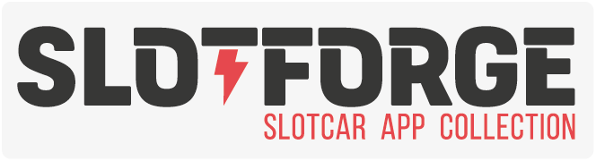
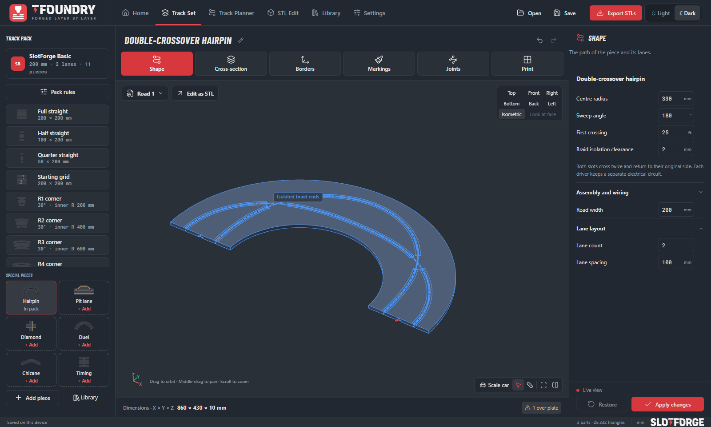
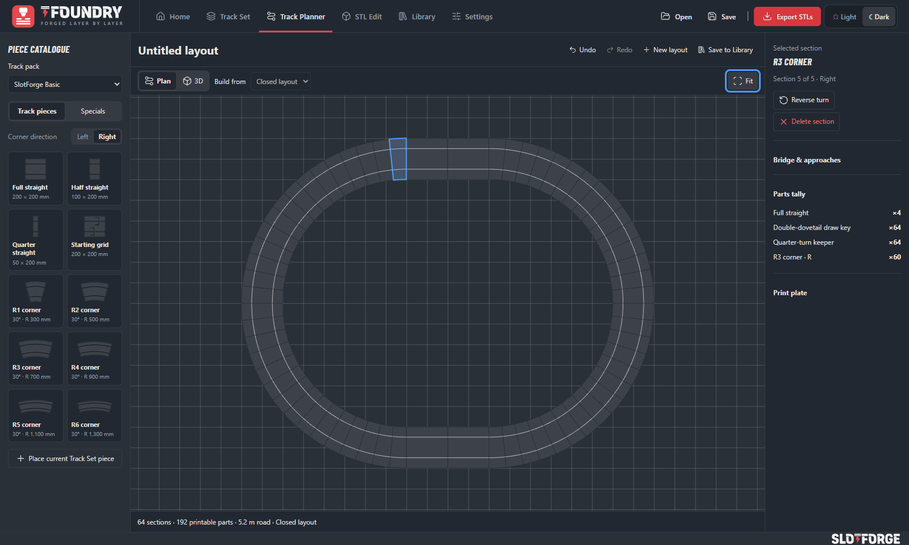
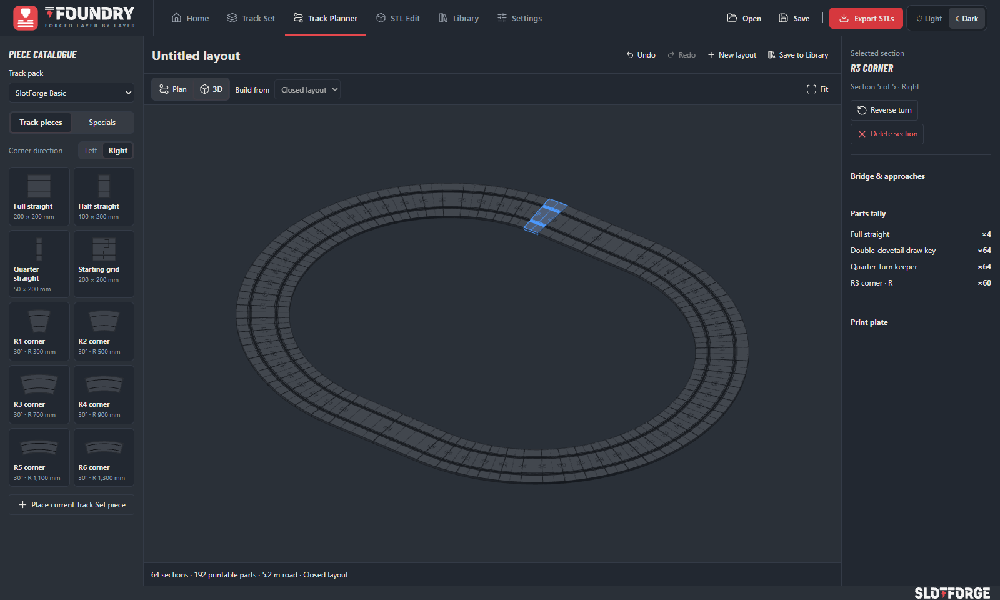
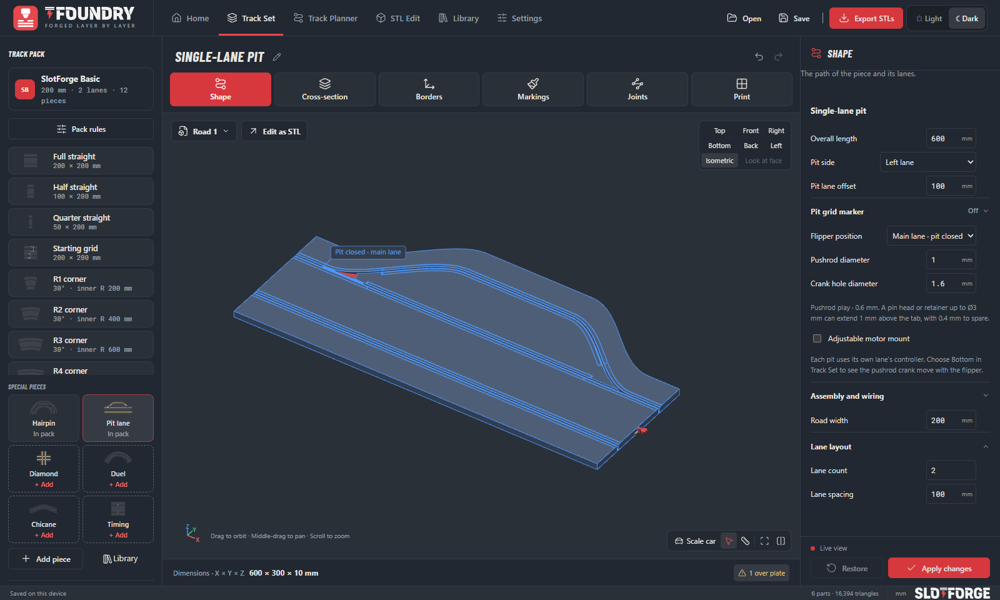
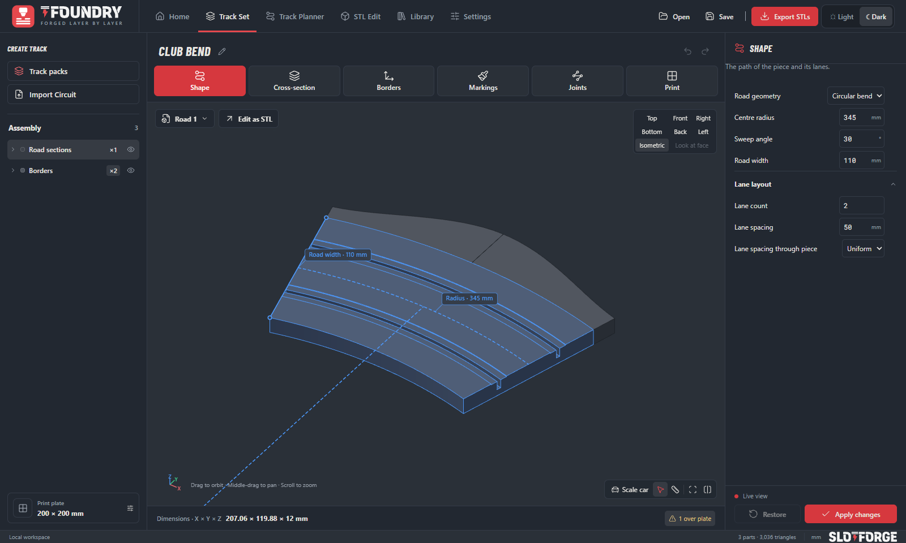
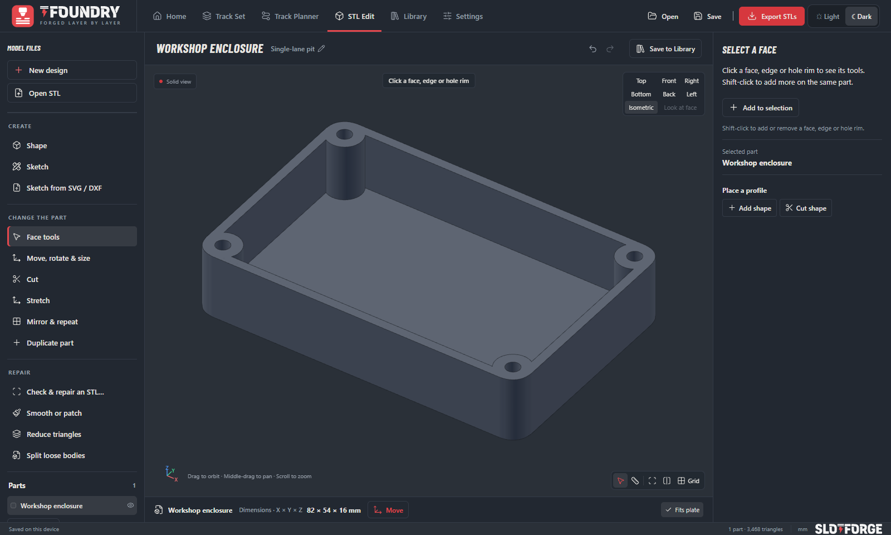
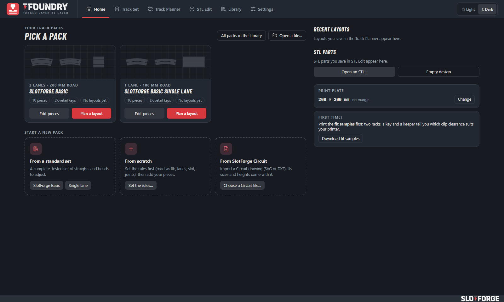

<p align="left">
  
  
</p>
<br clear="both">

# SlotForge Foundry

**Design the track. Print it. Race it.**

SlotForge Foundry turns slot-car track into parts you can 3D print. Start from a ready-made track pack, set your own road width, lanes and slot, or bring in a layout from **SlotForge Circuit**. Foundry builds every road section, border, clip and support as a printable STL, sized to fit your printer.

Plan a full layout in the Track Planner, add pit lanes, crossovers and timing straights, then export a complete print kit with quantities, an assembly map and notes. A full STL editor is built in for your own parts, from a bracket made from scratch to a fix on someone else's model.

**A desktop app for Windows, macOS and Linux. Your designs stay on your computer. No account required.**

[Download Foundry](https://github.com/theDutchmanJames/SlotForgeFoundry/releases/latest) · [See the app](#pictures-of-the-app) · [Explore the features](#features-and-functionality) · [How to install](#how-to-install) · [Report a problem](#reporting-problems)

## SlotForge App Collection

SlotForge Foundry is part of the **SlotForge App Collection**—apps for building tracks, managing your cars, designing their appearance and exploring their performance.

-  **[SlotForge Circuit](https://github.com/theDutchmanJames/SlotForgeCircuit)** — Design slotcar tracks, including routed and FreeForm layouts, and export track data for Timing's Live Tracker.
-  **[SlotForge Timing](https://github.com/theDutchmanJames/SlotForgeTiming)** — Lap timing, race management and custom race displays for analogue slot-car tracks.
-  **[SlotForge Paddock](https://github.com/theDutchmanJames/SlotForgePaddock)** — Organize your slotcar collection, photographs, parts, setups and maintenance in a virtual garage and workshop.
-  **[SlotForge Telemetry](https://github.com/theDutchmanJames/SlotForgeTelemetry)** — Explore gearing, motors, tyres and weight, compare setups, and analyse recorded lap times.
-  **[SlotForge Decals](https://github.com/theDutchmanJames/SlotForgeDecals)** — Size and arrange artwork into decal sheets, then export a PDF for printing.
-  **[SlotForge Livery](https://github.com/theDutchmanJames/SlotForgeLivery)** — Plan paint schemes, stripes, race numbers and decals on editable 2D car templates.

Visit each app's repository for its features, downloads and getting-started guide.

## Pictures of the app

**Track Set** — a double-crossover hairpin from the Special pieces shelf, with its isolated braid ends marked on the model.

[](docs/screenshots/special-hairpin.png)

| Track Planner | Planner in 3D | Single-lane pit |
| :---: | :---: | :---: |
| [](docs/screenshots/planner.png) | [](docs/screenshots/planner-3d.png) | [](docs/screenshots/special-pit.png) |
| Snap pieces into a layout and count every part. | Check the printed sections before exporting. | Pits, crossings and timing straights are built in. |

| Track Set | STL Edit | Home |
| :---: | :---: | :---: |
| [](docs/screenshots/track-set.png) | [](docs/screenshots/stl-editor.png) | [](docs/screenshots/home.png) |
| Edit the road, cross-section, borders, markings and joints. | Edit, repair and create STL models. | Pick a pack, open a part or start something new. |

Click any picture to open it at full size.

## Features and functionality

Foundry has four workspaces: **Track Set** for designing a piece, **Track Planner** for a layout, **STL Edit** for any model, and the **Library** that keeps them all. The [user guide](docs/GUIDE.md) covers every tool in detail.

### Start with a track pack

- **Two starter packs:** **SlotForge Basic** (two lanes on a 200 mm road) and **SlotForge Basic Single Lane** (100 mm). Each has three straights, a starting grid and six nesting 30° corners.
- **Make your own pack:** set the road width, lane count, slot spacing, first corner radius and default sweep, then add matching R1–R8 curves, straights or freeform paths. Shared print profiles keep the cross-section and connectors the same across the whole pack.
- **Import from SlotForge Circuit:** bring in a Circuit drawing (SVG or DXF) and Foundry builds the printable road from its lanes and edges.

### Design every detail of a piece

Each piece opens in **Track Set**, with large buttons for each part of the design:

- **Shape:** the road path, lanes and lane spacing. Squeeze or spread the lanes mid-piece while the ends stay aligned with the rest of the pack.
- **Slot position:** on a straight or curve with one to eight lanes, set the guide slots a typed distance from a road edge, with the lanes moving together or each lane set on its own. A straight can move the slots across in a smooth S, with one distance at end A and another at end B.
- **Cross-section:** a solid or hollow deck with underside ribs, the guide slot, braid recesses and braid pass-throughs.
- **Borders:** inside and outside borders with their own widths, apex and ends (rounded, tapered or S-curve).
- **Markings:** white lines, centre lines, kerbstones, starting grids and pit markers, with optional paint grooves cut into the print.
- **Joints:** the double-dovetail draw key with quarter-turn keepers, a Carrera-style fork, a side screw clip held by two wood screws, or tabs and sockets. Choose how many per joint and drag each one into place.
- **Print:** the number of print segments, checked against your print plate.

Every change shows live in the viewport before you apply it. A **Scale car** at 1:64, 1:43, 1:32 or 1:24 shows how a real car sits on the track.

### Special pieces

The **Special pieces** shelf in Track Set adds a ready-made special to your pack with one click:

- **Double-crossover hairpin** and **flat diamond crossing**, with isolated braid ends so each driver keeps a separate circuit.
- **Single-lane pit** with a printed flipper, pivot, crank and an optional adjustable motor mount.
- **Late-apex duel**, **bus-stop chicane** and **timing straight** with sensor pockets and cable exits.

Their print kits include a conductor map and assembly notes. For crossings, a test STL lets you check guide and braid clearance with your own cars.

### Plan a complete layout

- Open the **Track Planner**, pick a pack and click pieces to snap them together. Choose left or right for corners, reverse a turn, or delete and rejoin sections.
- Each piece is cut to fit your **print plate** automatically. The parts tally counts every road section, key and keeper.
- **Bridges and figure eights:** set the lift at each end of an upper road, and Foundry adds numbered support blocks clear of the road below.
- Switch to **3D** to see the generated parts, save the layout to the Library, and **Export STLs** for the full print kit with `parts.csv`.

### Print with confidence

- **Fit samples** let you test clip clearances with your own printer and filament before printing a whole track. The turning key for the keepers is included.
- Choose your printer or enter a custom plate. Plate checks include rotation, the full footprint and protruding connectors.
- Roads and borders export driving-face down, and each STL is centred on the bed. The print kit includes the separate STLs, quantities, a numbered assembly map and the editable project.
- A shopping list estimates the filament your layout needs.

### A full STL editor

- **Create from scratch:** dimensioned solids, sketches on a workplane or a picked face, and imported SVG/DXF outlines. Extrude, revolve, sweep and loft as a new part, join or cut, with an editable history.
- **Edit existing models:** trim, push/pull, tilt, hollow, add text and profiles. Countersink, counterbore, resize or fill holes. Round or chamfer edges, change walls, remove features and stretch a section.
- **Repair and refine:** inspect a damaged STL and patch openings, fix winding, smooth or patch curved surfaces, reduce triangles and split loose bodies.
- **Combine parts:** add more models, align them, and join, subtract or intersect them.
- Choose **Edit as STL** on any track part to take it into the editor.

### Keep a Library

The **Library** keeps your track packs, layouts and STL parts in SQLite on your computer. **Backup & restore** moves the whole Library to another computer or between the desktop and browser editions. **Save** downloads a single project as a `.slotfab` file.

### Make Foundry look the way you want

Choose **Dark** or **Light**, or one of the colour themes shared with the other SlotForge apps: Midnight blue, Forest green, Sunset orange, Violet, Carbon and yellow, and Ocean. You can also pick your own colours. Track parts keep their print colours in every theme.

## How to install

Open the **[latest release](https://github.com/theDutchmanJames/SlotForgeFoundry/releases/latest)** and expand **Assets**. Choose the finished app for your computer. **Desktop downloads need no Node.js, coding or terminal commands.** GitHub's automatic Source code downloads are for building it yourself.

| Your computer | Choose this download |
| --- | --- |
| **Windows · Intel/AMD 64-bit** | **Portable-x64.exe** to try the app, or **Setup-x64.exe** to install it for regular use. |
| **macOS · Apple Silicon and Intel** | **mac-universal.dmg**, or the **.zip** of the same app. |
| **Linux · Debian/Ubuntu-based** | **.deb** (amd64 or arm64), opened with your package installer. |
| **Linux · other distributions** | **.AppImage** (x86_64 or arm64), with permission to execute enabled. |
| **Any computer with a browser** | **SlotForge-Foundry-X.Y.Z.zip**: extract it and open **SlotForge Foundry.html**. |

### Windows: try Portable, then install if you like it

1. Download the file ending in **Portable-x64.exe**.
2. Double-click it and explore Foundry without installing. The portable app keeps everything in a **SlotForge Foundry Data** folder beside the program, so you can carry it on a USB stick.
3. If you like it and want to use it long term, download **Setup-x64.exe** and follow the installation wizard. It installs for your user account and needs no administrator rights.

Windows downloads are unsigned. If Windows shows a security prompt, check that the file came from this repository before choosing to run it.

### macOS

1. Download and open the **.dmg**.
2. Drag **SlotForge Foundry** into **Applications**.
3. Open it from Applications, then eject the disk image.

The Mac app is ad-hoc signed, not Apple Developer ID signed or notarized. If macOS blocks the first launch, use **System Settings → Privacy & Security → Open Anyway** if offered and you trust the download. The ZIP is an alternative: extract it and move the app into Applications.

### Linux

**Debian/Ubuntu-based systems:** open the **.deb** with your software/package installer, choose **Install**, then start Foundry from the applications menu.

**AppImage:** save the file, open **Properties → Permissions**, enable **Allow executing file as program** or your distribution's equivalent, then double-click it. AppImage support depends on your distribution and FUSE configuration; the DEB is an alternative on Debian-based systems. Like the Windows portable app, an AppImage keeps its data in a **SlotForge Foundry Data** folder beside it.

### Run or build from source

Use Node.js 24 and npm. Run `npm ci`, then `npm run dev` for a development server or `npm start` for the desktop app. `npm run dist:win`, `dist:mac` and `dist:linux` build the downloads. See [Desktop app](docs/DESKTOP.md) for the builds, the tests and where the data lives.

### Your first track

1. On **Home**, choose **Plan a layout** on SlotForge Basic.
2. Click **Full straight**, then a few **corners**, to build a small oval. Switch to **3D** to see the printed sections.
3. Open **Track Set** to change a piece: its road, cross-section, borders, markings or joints. Choose **Apply changes** to keep the edit.
4. Before printing a full track, download the **fit samples** from Home and print them to find the right clip clearance for your printer.
5. Choose **Export STLs** for the print kit, and save the layout to the **Library**.

### Updating, backups and moving computers

Foundry checks for a new release when it starts and shows what's new. Choose **Download** to save the new version in your Downloads folder, or **Skip this version**. Under **Settings → Updates**, choose **Check now** or switch off the check at start. Your packs, layouts and STL parts stay where they are when you update.

The installed app keeps its Library and settings in its user-data folder. On Windows this is normally:

```text
%APPDATA%/SlotForge Foundry/
```

On macOS it is `~/Library/Application Support/SlotForge Foundry`, and on Linux `~/.config/SlotForge Foundry`. **Help → Show data folder** opens it.

Before moving to another computer, choose **Library → Backup & restore** and keep the backup file somewhere safe. Restore it in Foundry on the new computer. The desktop and browser editions keep separate Libraries, and the same backup moves your work between them.

## Reporting problems

Open a [GitHub issue](https://github.com/theDutchmanJames/SlotForgeFoundry/issues) and include:

- Your app version and operating system.
- What you expected, what happened, and the steps needed to reproduce it.
- A screenshot and the exact error message, if one appears.
- For print problems: your printer, print plate, filament and the piece or layout. Attach the `.slotfab` or `.slotplan` file if you can.
- For Circuit imports: the Circuit version and the SVG or DXF file.

Use a small example where possible, and remove private information before sharing files. The [user guide](docs/GUIDE.md) may answer questions about a tool.

## License and copyright

SlotForge Foundry is made by theDutchmanJames. Copyright 2026 theDutchmanJames and contributors.

SlotForge Foundry is provided under the **SlotForge Source-Available License 1.0 — No Software Sales or Paid Access**.

- Personal, educational, club and internal business use are permitted without charge.
- You may study, modify and share free copies, keeping the license and notices and identifying your modifications.
- Selling the app, including modified versions or copies bundled into paid offerings, or charging for access requires separate written permission.
- You may use or sell your own track designs, track packs, STL models, print kits and printed parts, subject to any rights in included third-party material. This does not permit selling the app itself.
- Voluntary donations are allowed when access and use do not depend on payment.

See [LICENSE](LICENSE) for the full terms. Third-party components retain their own licenses; the notices are included with every download.

The Carrera-style fork uses *Carrera Slotcar Track Connector Clip* by URSUS, licensed [CC BY-SA 4.0](https://creativecommons.org/licenses/by-sa/4.0/). The double-dovetail key and quarter-turn keeper are original SlotForge Foundry designs.
